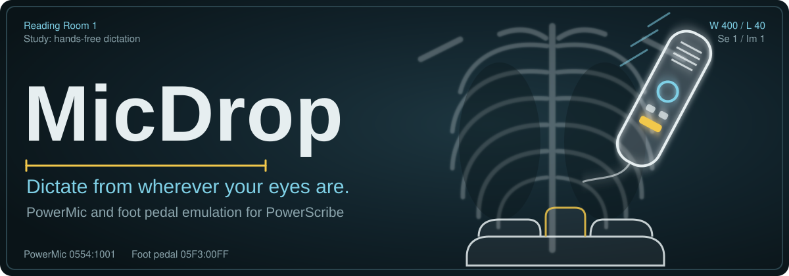

  

  <a href="https://powerup216.github.io/spork/"><b>Open the configurator</b></a>
  &nbsp;&nbsp;

---

Your eyes are on the images, your hand is on the mouse, and PowerScribe is buried two windows back. **MicDrop** is a small USB box that sits between your own keyboard and mouse and the workstation. It tells PowerScribe that a **PowerMic** or a **dictation foot pedal** is plugged in. Any key or button you choose becomes Dictate, Next Field or a pedal press, and PowerScribe gets it **without being the active window**.

Everything else on the keyboard and mouse passes through as normal.

## Two modes, one box

| | **PowerMic mode** | **Foot pedal mode** |
|---|---|---|
| PowerScribe sees | A PowerMic II | A 3-pedal dictation foot pedal |
| Buttons you can map | Dictate, Previous/Next Field, Transcribe, Rewind, Fast Forward, Stop/Play, Enter/Select, Custom Left/Right | Left, middle, right pedal |
| Default keys | F1 Previous Field, F2 Dictate, F3 Next Field, F4 Custom Left | F1 left, F2 middle, F3 right |

In PowerMic mode the box also shows up as a microphone in Windows Sound settings, the way a real PowerMic II does. It only sends silence, so keep PowerScribe's dictation audio set to your real microphone.

The firmware includes every mode, so you can switch between them in the configurator without reflashing.

## Reading-room setup

1. **Plug in your keyboard and mouse** to the board, and the board into the workstation.
2. **Open the [configurator](https://powerup216.github.io/spork/)** in Chrome or Edge. Click **Open foot pedal** if the board is in foot pedal mode (a new board is), or **Open PowerMic** if it's in PowerMic mode, and pick the board in the list.
3. **Pick a mode** in Settings: *PowerMic II* or *Foot Pedal*.
4. **Map your keys** in Mappings. The PowerMic and pedal buttons have their own section in the output list. The Examples tab has ready-made setups.
5. **Save to device**, then unplug and replug the board.

## If something's off

- **PowerScribe doesn't react.** First check the board in the matching tester. If the tester sees it, check that PowerScribe has the PowerMic or foot pedal enabled as an input device.
- **The board isn't in the list.** Try the other Open button: foot pedal mode connects as a serial port, PowerMic mode as a USB device.
- **Unplug other dictation devices** (a real PowerMic, another pedal) while you use MicDrop. PowerScribe may only listen to the first one it finds.
- **A key stopped typing.** That's expected: mapped keys are taken over. Remove or change the mapping in the configurator.

---

The configurator is MIT licensed (see <a href="LICENSE">LICENSE</a>).
